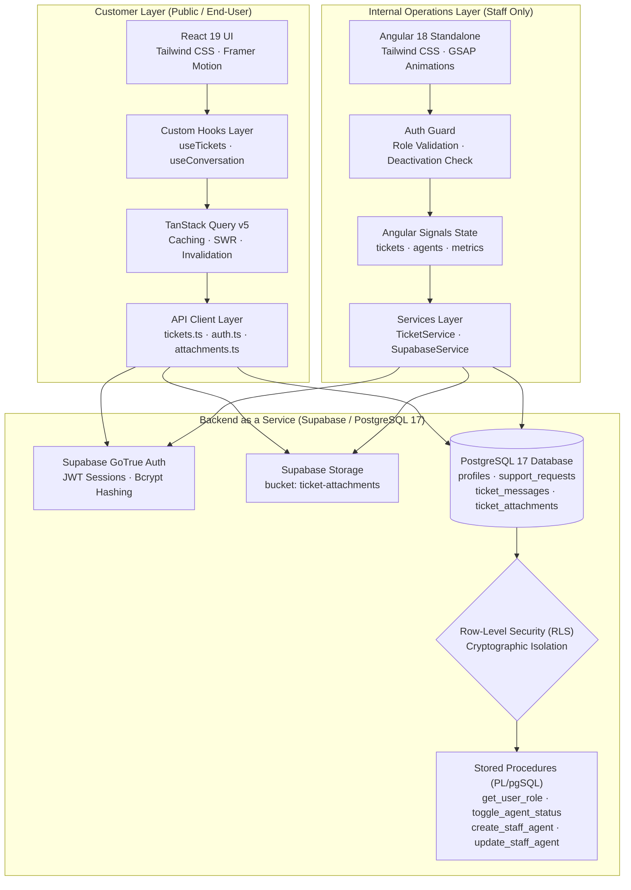
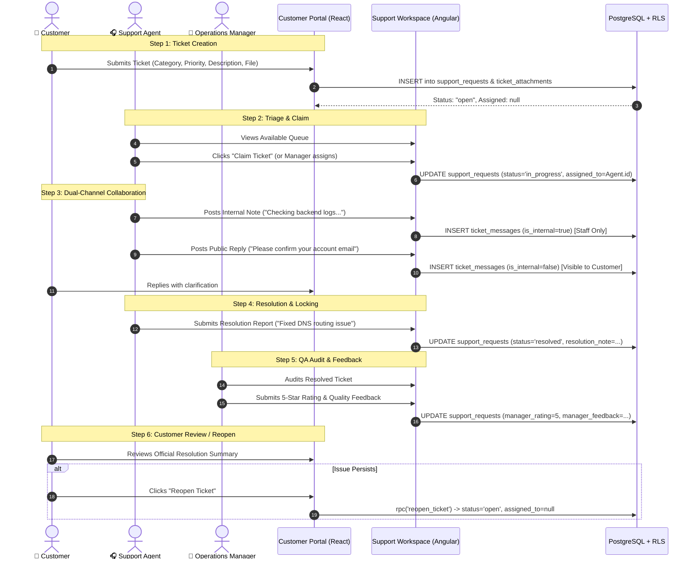
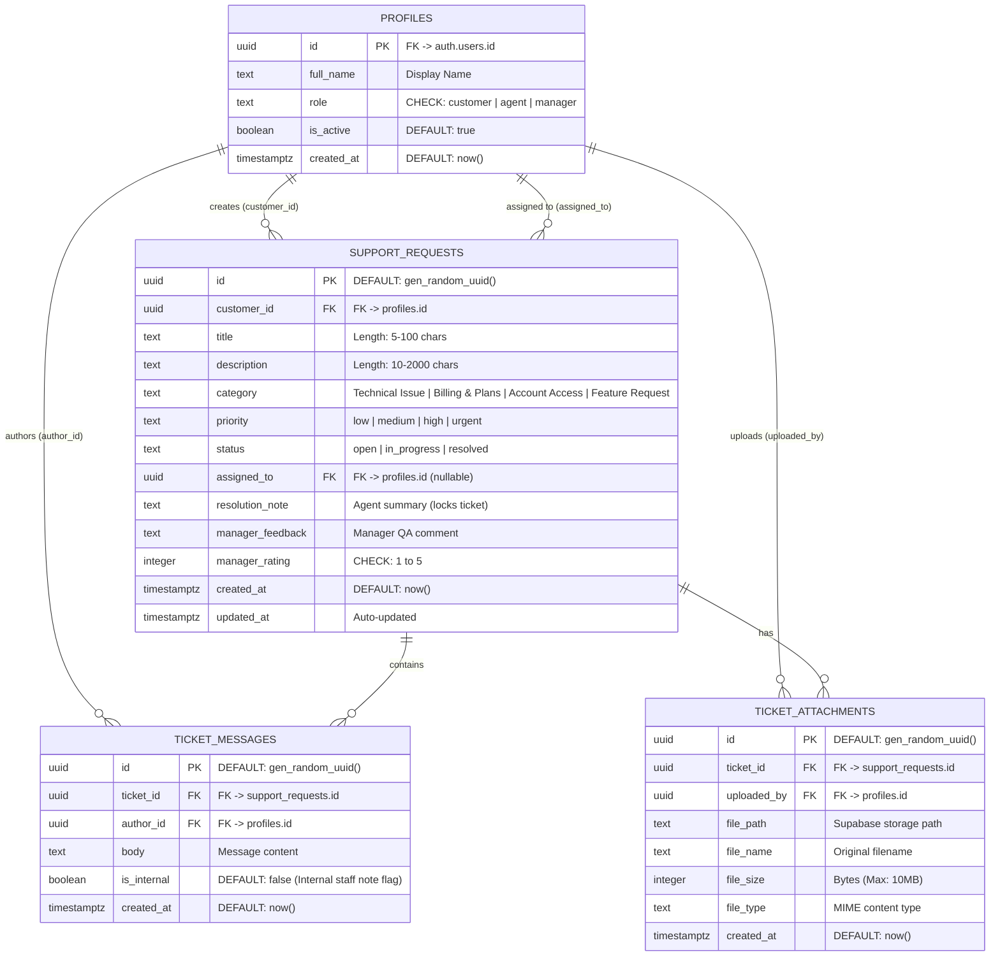

# 🛡️ Customer Support Operations Platform (CSOP)

[](https://www.typescriptlang.org/)
[](https://react.dev/)
[](https://angular.dev/)
[](https://supabase.com/)
[](https://tailwindcss.com/)
[](LICENSE)

An enterprise-grade, dual-frontend customer operations ecosystem designed for high-velocity SaaS and modern enterprise workflows. Built with a shared **PostgreSQL 17 / Supabase** backend, cryptographic **Row-Level Security (RLS)**, **Role-Based Access Control (RBAC)**, server-side pagination, multi-criteria filtering, dual-channel ticketing conversations, supervisor QA auditing, and staff lifecycle management.

---

## 📑 Table of Contents

- [🌟 Executive Summary & Real-World Context](#-executive-summary--real-world-context)
- [🏗️ System Architecture & Data Flow](#-system-architecture--data-flow)
- [👥 Personas & Role-Based Access Control (RBAC)](#-personas--role-based-access-control-rbac)
- [💻 Dual-Frontend Applications](#-dual-frontend-applications)
  - [1. Customer Portal (React 19)](#1-customer-portal-react-19)
  - [2. Support Workspace (Angular 18)](#2-support-workspace-angular-18)
- [🔄 Real-World Operations & Ticket Lifecycle](#-real-world-operations--ticket-lifecycle)
- [🗄️ Database Schema & Architecture](#️-database-schema--architecture)
- [🔐 Row-Level Security (RLS) & Cryptographic Policies](#-row-level-security-rls--cryptographic-policies)
- [⚙️ Stored Procedures & Database RPC Catalog](#️-stored-procedures--database-rpc-catalog)
- [📋 Form Validation & Security Hardening](#-form-validation--security-hardening)
- [🚀 Quick Start & Local Development](#-quick-start--local-development)
- [☁️ Production Deployment & Monorepo Configuration](#️-production-deployment--monorepo-configuration)
- [🧪 End-to-End Verification Scenarios](#-end-to-end-verification-scenarios)

---

## 🌟 Executive Summary & Real-World Context

### The Problem
Traditional monolithic customer support platforms often mix end-user client interfaces with internal operational triage queues, leading to:
- **Security & Data Leakage Risks:** Accidental exposure of internal triage notes, agent metrics, and sensitive cross-tenant data.
- **Suboptimal User Experience:** Overburdening simple customer inquiry forms with complex agent workflows, or giving agents slow, bloated interfaces.
- **Lack of Quality Oversight:** Inability for customer support managers to audit resolution quality, enforce SLAs, or monitor staff velocity in real-time.

### The Solution: Customer Support Operations Platform (CSOP)
CSOP delivers a **dual-frontend, single-backend architecture** separating customer interactions from internal staff operations while enforcing cryptographic data isolation directly at the database engine level.

```
┌──────────────────────────────────────────────────────────────────────────┐
│                             POSTGRESQL 17                                │
│        Cryptographic Row-Level Security (RLS) + SECURITY DEFINER RPCs    │
└──────────────────┬───────────────────────────────────┬───────────────────┘
                   │                                   │
       (JWT: role = 'customer')            (JWT: role = 'agent'|'manager')
                   │                                   │
                   ▼                                   ▼
┌─────────────────────────────────────┐ ┌──────────────────────────────────┐
│       CUSTOMER PORTAL (React 19)    │ │   SUPPORT WORKSPACE (Angular 18) │
│ • Self-service inquiry creation     │ │ • Agent queue triage & claim     │
│ • SLA progress tracking             │ │ • Dual-channel conversation      │
│ • Secure attachment uploads (10MB)  │ │ • Resolution reports & locks     │
│ • Real-time conversation thread     │ │ • Manager QA audit & 1-5★ rating │
│ • Verified resolution review        │ │ • Staff provisioning & lifecycle │
└─────────────────────────────────────┘ └──────────────────────────────────┘
```

---

## 🏗️ System Architecture & Data Flow



---

## 👥 Personas & Role-Based Access Control (RBAC)

The platform provides dedicated persona flows with zero cross-tenant contamination:

| Persona | Interface | Capabilities & Real-World Responsibilities | Demo Credentials |
|:---|:---|:---|:---|
| **Customer** | Customer Portal (React 19) | Creates support requests, tracks live status, uploads attachments, exchanges public messages with agents, reads verified resolution notes, reopens tickets if needed, and manages profile credentials. | `customer@portal.com`<br/>`password123` |
| **Support Agent** | Support Workspace (Angular 18) | Triages unassigned queue, claims tickets, updates status (`Open` → `In Progress`), drafts internal private notes, replies to customer tickets, resolves tickets with mandatory resolution summaries (locking ticket). | `agent@support.com`<br/>`password123` |
| **Operations Manager** | Support Workspace (Angular 18) | Full queue oversight, manual ticket assignment to active agents, audits resolved tickets with 1–5 star QA scores & feedback, onboards new staff, edits/deactivates/removes agent accounts, views performance analytics. | `manager@support.com`<br/>`password123` |

---

## 💻 Dual-Frontend Applications

### 1. Customer Portal (React 19)

A sleek, consumer-focused portal styled with **Electric Indigo (`#6366f1`)** glassmorphism and subtle Framer Motion micro-animations.

```
customer-portal/
├── src/
│   ├── api/             # Typed Supabase API integration (tickets, auth, attachments, messages)
│   ├── components/      # UI components (TicketList, TicketCard, StatsCards, DetailModal, CreateModal)
│   ├── context/         # AuthContext with session hydration & role enforcement
│   ├── hooks/           # TanStack Query hooks (useTickets, useTicketDetail, useConversation)
│   ├── lib/             # Query client configuration & toast notifications
│   ├── pages/           # LandingPage, LoginPage, DashboardPage
│   ├── routes/          # AppRoutes with ProtectedRoute wrapper
│   ├── schemas/         # Zod schemas for forms and ticket inputs
│   └── types/           # Strong TypeScript interfaces for tickets, users, and conversations
```

#### Key Capabilities:
- **Interactive Landing Page:** Dual-portal switcher with quick-access links to both customer and staff portals.
- **Account Registration & Password Complexity:** Real-time password requirement checklist (8+ chars, uppercase, lowercase, number, symbol) with instant validation feedback.
- **Customer KPI Dashboard:** Live count indicators for *Total Tickets*, *Open*, *In Progress*, and *Resolved*.
- **Freshdesk-Inspired Views:** Seamless toggle between dense **Table/List View** and visual **Card View**.
- **Server-Side Pagination & Filtering:** Multi-criteria filters by Status, Priority, Category, Date Range (Last 7/30/90 days), and Keyword Search (`ilike`).
- **Rich Ticket Detail Modal:** Displays current SLA stage, assignee information, verified resolution reports, attachments preview, and public customer-agent messaging.
- **Ticket Reopening:** Customers can reopen previously resolved tickets if their issue persists via the `reopen_ticket` RPC.
- **Help Center & FAQ:** Accordion-based knowledge base for self-service problem resolution.

---

### 2. Support Workspace (Angular 18)

A high-density, mission-critical workspace engineered for speed, styled with **Operations Emerald (`#10b981`)** glassmorphism and GSAP animations.

```
support-workspace/src/app/
├── components/
│   ├── analytics-view/        # Operational charts, resolution velocity, category distribution
│   ├── custom-select/         # Accessible glassmorphic dropdowns
│   ├── manager-panel/         # Executive staff directory, agent onboarding & QA dashboard
│   ├── password-complexity/   # Real-time regex strength meter
│   ├── settings-view/         # Staff credential & preferences management
│   ├── sidebar/               # Role-based navigation with live ticket counts
│   ├── stats-overview/        # Role-specific KPI metrics (Unassigned Queue, Avg QA Rating, etc.)
│   ├── ticket-detail-modal/   # Ticket triage console with conversation thread & QA audit widget
│   └── ticket-queue/          # Dense ticket table with batch actions and inline assignment
├── core/
│   ├── errors/                # Global un-crashable error handler
│   ├── guards/                # authGuard enforcing role authorization & staff active status
│   ├── models/                # TypeScript models (SupportTicket, AgentOverview, Message, Attachment)
│   └── services/              # SupabaseService, TicketService, ConversationService, ToastService
└── pages/
    ├── dashboard/             # Main triage and management hub
    └── login/                 # Staff authentication console with demo shortcuts
```

#### Key Capabilities:
- **Agent Queue & Ticket Claiming:** Agents can view the unassigned queue and claim tickets with one click, transitioning them immediately to `in_progress`.
- **Dual-Channel Conversation Thread:**
  - **Public Reply:** Visible to both customer and staff.
  - **Internal Note (`is_internal: true`):** Highlighted with a distinct golden badge, strictly hidden from customers via database RLS.
- **Resolution Locking:** Submitting a resolution report permanently moves the ticket to `resolved` and locks customer edits while generating an official summary report.
- **Manager Quality Assurance (QA) Auditing:** Operations managers can review resolved tickets and attach an interactive **1–5 Star Rating** and supervisor feedback notes.
- **Executive Staff Management Console:**
  - **Onboard Staff:** Provision new support agents with email, name, and secure credentials.
  - **Performance Leaderboard:** Real-time visibility into each agent's assigned count, resolved count, and average QA rating.
  - **Active / Deactivated Toggle:** Deactivating an agent instantly revokes their login rights and unassigns open tickets back to the queue.
  - **Edit & Remove:** Full CRUD capability over staff profiles.
- **Real-Time Operational Analytics:** Visual distribution charts of ticket categories, priority distribution, and staff workload balance.

---

## 🔄 Real-World Operations & Ticket Lifecycle



---

## 🗄️ Database Schema & Architecture



---

## 🔐 Row-Level Security (RLS) & Cryptographic Policies

RLS is enabled on **all tables** and storage buckets. Policies are evaluated on every query using the session's JWT `auth.uid()`:

### 1. `profiles` Table
| Policy Name | Target Role | Command | SQL Rule / WITH CHECK |
|:---|:---|:---|:---|
| `Users can view own profile` | All | `SELECT` | `id = auth.uid()` |
| `Staff can view all profiles` | Agent / Manager | `SELECT` | `get_user_role() IN ('agent', 'manager')` |
| `Users can update own display name` | All | `UPDATE` | `id = auth.uid()` *(prevents role or is_active escalation)* |
| `No Direct Insert/Delete` | — | `INSERT/DELETE` | Blocked — handled exclusively by `SECURITY DEFINER` procedures. |

### 2. `support_requests` Table
| Policy Name | Target Role | Command | SQL Rule / WITH CHECK |
|:---|:---|:---|:---|
| `Customers view own tickets` | Customer | `SELECT` | `customer_id = auth.uid()` |
| `Staff view all tickets` | Agent / Manager | `SELECT` | `get_user_role() IN ('agent', 'manager')` |
| `Customers insert tickets` | Customer | `INSERT` | `customer_id = auth.uid()` |
| `Customers update own open tickets` | Customer | `UPDATE` | `customer_id = auth.uid() AND status != 'resolved'` |
| `Staff update tickets` | Agent / Manager | `UPDATE` | `get_user_role() IN ('agent', 'manager')` |

### 3. `ticket_messages` Table
| Policy Name | Target Role | Command | SQL Rule / WITH CHECK |
|:---|:---|:---|:---|
| `Customers view public replies` | Customer | `SELECT` | `is_internal = false AND ticket_id IN (SELECT id FROM support_requests WHERE customer_id = auth.uid())` |
| `Staff view all messages & notes` | Agent / Manager | `SELECT` | `get_user_role() IN ('agent', 'manager')` |
| `Customers send public replies` | Customer | `INSERT` | `author_id = auth.uid() AND is_internal = false AND ticket_id IN (SELECT id FROM support_requests WHERE customer_id = auth.uid())` |
| `Staff send replies & internal notes` | Agent / Manager | `INSERT` | `author_id = auth.uid() AND get_user_role() IN ('agent', 'manager')` |

### 4. `ticket_attachments` Table & Storage
| Policy Name | Target Role | Command | SQL Rule / WITH CHECK |
|:---|:---|:---|:---|
| `Customers view own attachments` | Customer | `SELECT` | `ticket_id IN (SELECT id FROM support_requests WHERE customer_id = auth.uid())` |
| `Staff view all attachments` | Agent / Manager | `SELECT` | `get_user_role() IN ('agent', 'manager')` |
| `Authorized upload` | Customer / Staff | `INSERT` | Validated against ticket ownership or staff status |

---

## ⚙️ Stored Procedures & Database RPC Catalog

All privileged operations are encapsulated in PostgreSQL `SECURITY DEFINER` stored procedures to prevent client-side injection and privilege escalation:

| Procedure Signature | Access Level | Description & Operational Workflow |
|:---|:---|:---|
| `get_user_role()` | Public | Helper function returning the caller's role (`customer`, `agent`, `manager`) for fast RLS evaluation. |
| `register_customer(customer_email, customer_password, customer_name)` | Anon / Public | Safely registers a customer with pre-confirmed email status, GoTrue Bcrypt `$2b$10` password hashing, and auto-provisions a `profiles` record. |
| `create_staff_agent(agent_email, agent_password, agent_name)` | Manager Only | Onboards a new support agent with proper credentials and sets `role = 'agent'`. |
| `update_staff_agent(target_user_id, new_email, new_name, new_password)` | Manager Only | Modifies staff name, email, and optionally resets their password securely. |
| `toggle_agent_status(target_user_id, active_status)` | Manager Only | Toggles staff `is_active` flag. When deactivating (`active_status = false`), automatically unassigns active tickets back to the open queue. |
| `delete_staff_agent(target_user_id)` | Manager Only | Removes an agent's account, unassigns their active tickets, and cleans up identity records. |
| `get_agents_overview()` | Manager Only | Aggregates staff performance metrics: total assigned, total resolved, and real-time average QA ratings. |
| `reopen_ticket(ticket_id)` | Customer / Staff | Reopens a resolved ticket, clears resolution locks, and resets status to `open`. |

---

## 📋 Form Validation & Security Hardening

### Defense-in-Depth Architecture

```
┌─────────────────────────────────────────────────────────┐
│ Layer 1: Client Validation (Zod & Angular Reactive Forms)│
├─────────────────────────────────────────────────────────┤
│ Layer 2: UI Route Guards (AuthGuard & Role Protection)  │
├─────────────────────────────────────────────────────────┤
│ Layer 3: Supabase GoTrue Authentication (JWT Sessions)  │
├─────────────────────────────────────────────────────────┤
│ Layer 4: PostgreSQL Row-Level Security (RLS Engine)     │
├─────────────────────────────────────────────────────────┤
│ Layer 5: Stored Procedures (SECURITY DEFINER with checks│
└─────────────────────────────────────────────────────────┘
```

### Form Constraints Matrix

| Input Field | Validation Rules | Error Prevention |
|:---|:---|:---|
| **Email Address** | RFC 5322 compliant, lowercased, trimmed | Prevents duplicate casing collisions |
| **Password** | Min 8 chars, 1 uppercase, 1 lowercase, 1 digit, 1 special symbol | Rejects weak credentials with visual complexity meter |
| **Ticket Title** | 5 to 100 characters, trimmed | Prevents empty or overly long titles |
| **Ticket Description** | 10 to 2,000 characters, trimmed | Ensures actionable ticket detail |
| **Attachment Size** | Maximum 10MB per file | Enforced via client check and storage bucket policies |
| **Resolution Note** | Minimum 10 characters | Required before an agent can transition a ticket to `resolved` |
| **Manager QA Rating** | Strict Integer (1, 2, 3, 4, 5) | Enforced by PostgreSQL `CHECK` constraint |

---

## 🚀 Quick Start & Local Development

### Prerequisites
- **Node.js**: `v20.x` or higher
- **npm**: `v10.x` or higher
- **Supabase Account / Project**

---

### Step 1: Clone Repository
```bash
git clone https://github.com/zyadmoataz/Customer-Support-Operations-Platform.git
cd Customer-Support-Operations-Platform
```

---

### Step 2: Configure Environment Variables

#### Customer Portal (`customer-portal/.env`):
```bash
cd customer-portal
cp .env.example .env
```
Edit `.env`:
```env
VITE_SUPABASE_URL=https://your-project-ref.supabase.co
VITE_SUPABASE_ANON_KEY=your-publishable-anon-key
```

#### Support Workspace (`support-workspace/src/environments/environment.ts`):
```bash
cd ../support-workspace
cp src/environments/environment.example.ts src/environments/environment.ts
```
Edit `environment.ts`:
```typescript
export const environment = {
  production: false,
  supabaseUrl: 'https://your-project-ref.supabase.co',
  supabaseKey: 'your-publishable-anon-key'
};
```

---

### Step 3: Run Both Applications

#### Launch Customer Portal (React):
```bash
cd customer-portal
npm install
npm run dev
# 🚀 Runs at http://localhost:5173
```

#### Launch Support Workspace (Angular):
```bash
cd support-workspace
npm install
npx ng serve
# 🚀 Runs at http://localhost:4200
```

---

## ☁️ Production Deployment & Monorepo Configuration

The monorepo is configured for one-click deployment to **Vercel** with two distinct applications:

### Monorepo Vercel Settings

| Setting | Customer Portal (React) | Support Workspace (Angular) |
|:---|:---|:---|
| **Root Directory** | `customer-portal` | `support-workspace` |
| **Framework Preset** | `Vite` | `Angular` |
| **Build Command** | `npm run build` | `npm run build` |
| **Output Directory** | `dist` | `dist` |

### Build Verification
Both applications compile with **0 TypeScript and 0 Angular errors**:
```bash
# Verify Customer Portal
npm --prefix customer-portal run build

# Verify Support Workspace
npm --prefix support-workspace run build
```

---

## 🧪 End-to-End Verification Scenarios

To experience the full operations lifecycle, follow this step-by-step verification scenario:

### Scenario: End-to-End Resolution & QA Audit Lifecycle

1. **Customer Creates Ticket:**
   - Sign in to Customer Portal (`customer@portal.com` / `password123`) or register a new customer account.
   - Click **"New Request"**, choose `Technical Issue`, set Priority to `High`, attach a screenshot, and submit.
   - Observe the ticket in the list with `open` status badge.

2. **Agent Claims Ticket:**
   - Sign in to Support Workspace (`agent@support.com` / `password123`).
   - Find the ticket in the Available Queue and click **"Claim"**.
   - Notice the ticket moves to `in_progress` and is assigned to Agent Smith.

3. **Discussion & Internal Notes:**
   - Open ticket details.
   - Post an **Internal Note** (private staff note).
   - Post a **Public Reply** to the customer.
   - Switch back to Customer Portal and confirm only the public reply is visible (internal note is hidden).

4. **Resolution & Locking:**
   - In Support Workspace, click **"Resolve Ticket"**.
   - Enter the resolution note (e.g. *"Resolved server DNS cache misconfiguration"*).
   - Confirm the ticket is locked and displays the official resolution summary.

5. **Manager Quality Audit:**
   - Sign in to Support Workspace as Manager (`manager@support.com` / `password123`).
   - Open the resolved ticket and submit a **5-Star QA Rating** with supervisor feedback.
   - Navigate to the **Manager Panel** and observe the agent's updated average QA rating and resolution metrics.

6. **Staff Lifecycle Management:**
   - In the Manager Panel, onboard a new agent or click **"Deactivate"** on an existing agent.
   - Observe the real-time status change badge and automatic unassignment of their open tickets.
   - Verify that deactivated agents cannot log into the workspace.

---

## 📄 License
This project is open-source software licensed under the **MIT License**.
