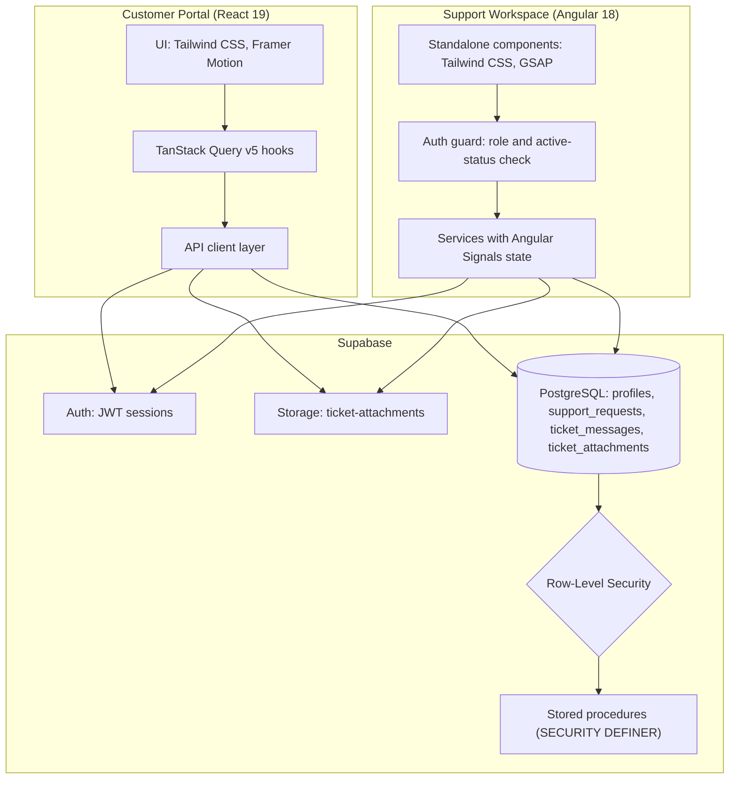
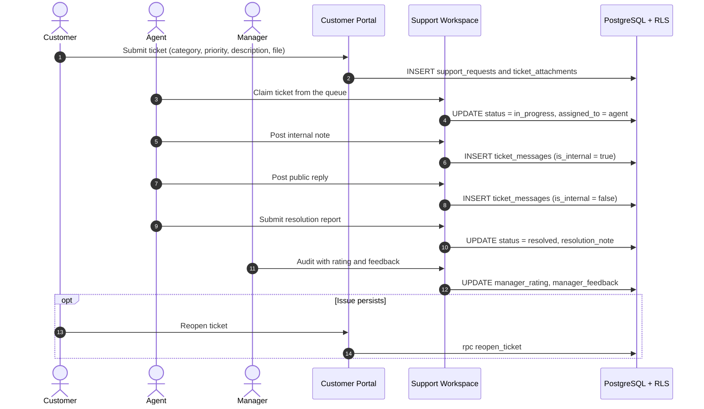
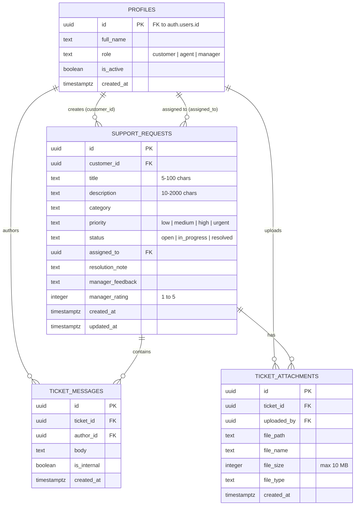

# Customer Support Operations Platform (CSOP)

[](https://www.typescriptlang.org/)
[](https://react.dev/)
[](https://angular.dev/)
[](https://supabase.com/)
[](https://tailwindcss.com/)

A support-ticketing system with two frontends on one Supabase backend: a **React customer portal** for submitting and tracking tickets, and an **Angular staff workspace** for triage, resolution and manager QA audits. Access rules are enforced in the database with Row-Level Security (RLS) and role-checked stored procedures, not only in the UI.

**Live demo**
- Support Workspace (Angular): [CONFIRM: URL, probably https://customer-support-operations-platfor.vercel.app/]
- Customer Portal (React): [CONFIRM: URL]


## Demo accounts
Shared demo accounts with sample data only. [CONFIRM: data is reset periodically, or say it is not]

| Role | App | Email | Password |
|:---|:---|:---|:---|
| Customer | Customer Portal | `customer@portal.com` | `password123` |
| Support Agent | Support Workspace | `agent@support.com` | `password123` |
| Operations Manager | Support Workspace | `manager@support.com` | `password123` |

## The idea
Customer-facing and internal support interfaces have different needs and different risks. CSOP keeps them as **two separate apps** that share one database. Staff-only data, such as internal notes and agent metrics, is hidden from customers by RLS policies at the database level, so a bug in a frontend cannot expose it.

## Architecture



## Roles

| Role | App | What they can do |
|:---|:---|:---|
| **Customer** | Customer Portal | Create tickets, track status, upload attachments (up to 10 MB), exchange public messages, read resolution notes, reopen resolved tickets, manage their profile |
| **Support Agent** | Support Workspace | See the unassigned queue, claim tickets, update status, write internal notes and public replies, resolve tickets with a required summary |
| **Operations Manager** | Support Workspace | Oversee the full queue, assign tickets to active agents, audit resolved tickets with a 1 to 5 rating and feedback, onboard, edit, deactivate and remove agents, view analytics |

## Features

### Customer Portal (React 19)
- Ticket dashboard with live counts (total, open, in progress, resolved)
- Table and card views
- Server-side pagination and filters: status, priority, category, date range (7, 30 or 90 days) and keyword search
- Ticket detail with SLA stage, assignee, resolution report, attachments and a public conversation thread
- Reopen resolved tickets (`reopen_ticket` RPC)
- Registration with a live password-strength checklist, plus a Help Center and FAQ

### Support Workspace (Angular 18)
- Agent queue with one-click claiming (moves the ticket to `in_progress`)
- Two-channel conversation: public replies, and internal notes (`is_internal = true`) that RLS hides from customers
- Resolution report that locks the ticket
- Manager QA audit: 1 to 5 star rating and feedback on resolved tickets
- Staff management: onboard agents, edit, deactivate and remove. Deactivating an agent revokes access and returns their open tickets to the queue
- Performance view: assigned count, resolved count and average QA rating per agent
- Analytics: category and priority distribution and workload balance

## Tech stack

| Layer | Technology |
|:---|:---|
| Customer Portal | React 19, Vite, TypeScript, TanStack Query v5, Zod, Tailwind CSS, Framer Motion [CONFIRM: React Router] |
| Support Workspace | Angular 18 (standalone components, Signals), TypeScript, Tailwind CSS, GSAP, Reactive Forms |
| Backend | Supabase: PostgreSQL, Auth (JWT), Storage, RLS, PL/pgSQL functions |
| Hosting | Vercel (monorepo, two projects) |

## Ticket lifecycle



## Database schema



## Security model

RLS is enabled on all tables and on the storage bucket. Every query is evaluated against the caller's `auth.uid()` and role.

| Table | Customers | Staff (agent / manager) |
|:---|:---|:---|
| `profiles` | Read and update own profile | Read all profiles |
| `support_requests` | Read, insert and update own tickets that are not resolved | Read and update all tickets |
| `ticket_messages` | Read public messages on own tickets; send public replies | Read all messages and internal notes; send replies and notes |
| `ticket_attachments` | Read attachments on own tickets | Read all attachments |

Privileged operations run as `SECURITY DEFINER` functions with role checks inside:

| Function | Who can call it | Purpose |
|:---|:---|:---|
| `get_user_role()` | Authenticated | Returns the caller's role for RLS policies |
| `register_customer(...)` | Anonymous | Creates a customer account and profile |
| `create_staff_agent(...)` | Manager | Onboards an agent |
| `update_staff_agent(...)` | Manager | Edits an agent's name or email, or resets a password |
| `toggle_agent_status(...)` | Manager | Activates or deactivates an agent and returns their open tickets to the queue |
| `delete_staff_agent(...)` | Manager | Removes an agent and unassigns their tickets |
| `get_agents_overview()` | Manager | Per-agent assigned, resolved and average QA rating |
| `reopen_ticket(ticket_id)` | Customer / Staff | Reopens a resolved ticket |

Validation runs in layers: client forms (Zod and Angular Reactive Forms), route guards, Supabase Auth (JWT), RLS, and checks inside the stored procedures. Database `CHECK` constraints enforce the rating range (1 to 5) and field lengths.

## Known limitations
- `register_customer` pre-confirms the email address, so there is no email verification. That is fine for a demo; a production system should verify emails.
- [CONFIRM: how role and `is_active` changes on `profiles` are blocked for normal users, for example column-level grants or a trigger. A policy of `id = auth.uid()` alone does not prevent a user from editing those columns. Describe the mechanism here.]
- [CONFIRM: how customers are prevented from changing fields such as `assigned_to` or `status` on their own tickets, for example column-level grants or RPCs.]
- [CONFIRM: automated tests. Say "none yet" if there are none, or list what exists.]

## Run locally

Requirements: Node.js 20 or higher, npm 10 or higher, and a Supabase project.

```bash
git clone https://github.com/zyadmoataz/Customer-Support-Operations-Platform.git
cd Customer-Support-Operations-Platform
```

**Customer Portal**
```bash
cd customer-portal
cp .env.example .env     # set VITE_SUPABASE_URL and VITE_SUPABASE_ANON_KEY
npm install
npm run dev              # http://localhost:5173
```

**Support Workspace**
```bash
cd support-workspace
cp src/environments/environment.example.ts src/environments/environment.ts   # set supabaseUrl and supabaseKey
npm install
npx ng serve             # http://localhost:4200
```

[CONFIRM: where the SQL schema, policies and functions live in the repo (for example `supabase/migrations`) and how to apply them. Never commit real keys.]

## Deploy (Vercel monorepo)

| Setting | Customer Portal | Support Workspace |
|:---|:---|:---|
| Root directory | `customer-portal` | `support-workspace` |
| Framework preset | Vite | Angular |
| Build command | `npm run build` | `npm run build` |
| Output directory | `dist` | `dist` [CONFIRM: Angular output path] |

## Try the full flow
1. In the Customer Portal, sign in as the customer and create a ticket with an attachment.
2. In the Support Workspace, sign in as the agent, claim the ticket, post an internal note and a public reply.
3. Back in the Customer Portal, confirm only the public reply is visible.
4. As the agent, resolve the ticket with a resolution note.
5. As the manager, rate the resolved ticket and check the agent's average rating in the Manager Panel.
6. As the manager, deactivate an agent and confirm their open tickets return to the queue.

## License
[CONFIRM: MIT, only if a LICENSE file exists in the repo. Otherwise delete this section.]
